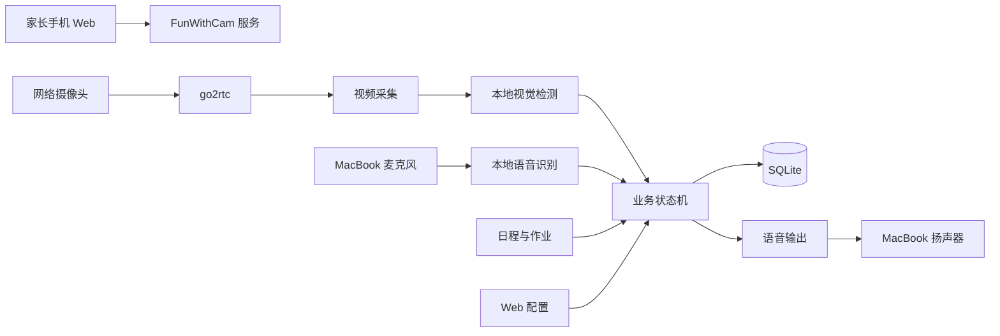
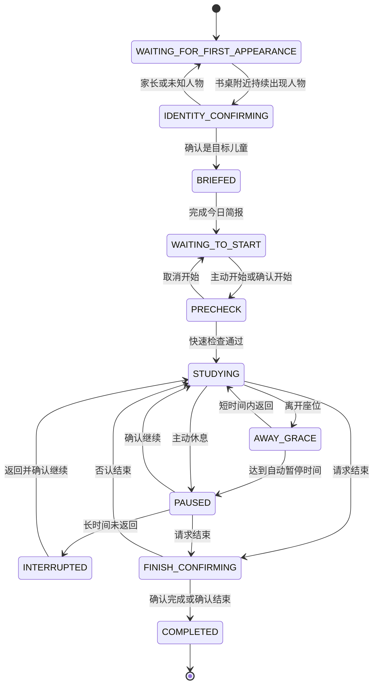

# FunWithCam 产品与业务逻辑说明

## 1. 文档信息

- 产品名称：FunWithCam
- 文档类型：产品目标、核心流程与业务逻辑说明
- 文档版本：V2 草案
- 更新日期：2026-10-10
- 当前目标用户：一个约 8 岁的儿童及其家长
- 部署环境：家庭局域网、固定网络摄像头、一台旧 MacBook

本文档整合当前产品构想和已确认的业务逻辑，用于指导后续产品设计、数据设计和分阶段开发。

截至 2026-10-11，代码已实现家庭 Web 录入、本地人脸身份、首次今日简报和可配置第二次提醒的闭环。本文档同时包含后续语音输入、长期基准、姿势检测和统计目标；未完成部分不表示当前版本已经具备。

---

## 2. 产品定位

FunWithCam 是一个运行在家庭局域网内的本地学习助理。

系统通过网络摄像头观察书桌附近和学习座位，通过旧 MacBook 完成本地计算、语音收音和语音外放，并通过家庭局域网 Web 页面让家长录入日程、作业和调整规则。

产品希望形成以下闭环：

```text
家长录入今日安排
→ 孩子第一次来到书桌附近
→ 系统确认身份并播报今日简报
→ 到达可配置的第二次提醒时间
→ 孩子通过语音开始学习
→ 系统进行灯光、位置和姿势检查
→ 学习过程中低打扰地检测、记录和提醒
→ 孩子休息、继续或结束
→ 系统记录学习会话、异常事件和时间统计
→ 家长通过 Web 查看当天记录和长期趋势
```

产品不是单纯的摄像头监控工具，也不是医学姿态诊断工具。它更接近一个温和的家庭学习流程教练：

- 告知今天需要做什么；
- 帮助孩子开始并维持学习节奏；
- 在必要时进行少量提醒；
- 保存客观记录供家长了解趋势；
- 给孩子保留主动开始、休息、继续和暂停提醒的权利。

---

## 3. 产品目标

### 3.1 提醒

- 孩子工作日放学后第一次来到书桌附近时，播报今日简要安排；
- 节假日第一次来到书桌附近时，播报当日安排；
- 在家长配置的时间进行第二次开始提醒；
- 在课程准备、出发等明确时间点进行硬性日程提醒；
- 学习期间对持续、可信且值得纠正的问题进行温和提醒；
- 作业完成后引导孩子检查书包和收尾事项。

### 3.2 交互

- 支持通过语音开始、暂停、继续和结束学习；
- 支持通过语音完成长期基准校正流程；
- 支持询问“今天有什么作业”“今天有什么课”“某节课几点开始”等本地事实；
- 支持语文、英语等主动打卡；
- 支持孩子反馈“这个提醒不对”“暂停姿势提醒”等。

### 3.3 统计

- 统计每次学习的总经过时间和在座学习时间；
- 统计主动休息、短暂离座和长时间中断；
- 统计头部过低、身体前倾、身体歪斜和光线偏暗等事件；
- 统计实际播放提醒的次数及提醒后恢复时间；
- 提供按天、按周的趋势，而不是生成单一的“好坏分数”。

---

## 4. 非目标

第一阶段及可预见版本不承诺：

- 判断作业答案是否正确；
- 判断孩子是否真正专注；
- 判断儿童情绪或心理状态；
- 提供医学级坐姿、脊柱或视力诊断；
- 精确测量眼睛与书本之间的实际厘米距离；
- 可靠判断每一本书是否已经装进书包；
- 持续保存家庭原始视频或连续音频；
- 使用云端持续分析儿童影像；
- 强制阻止孩子休息、结束学习或离开座位；
- 使用综合分数评价孩子是否“认真”或“乖”。

---

## 5. 核心设计原则

### 5.1 本地与隐私优先

- 视频、音频、人脸特征和学习记录默认只保存在家庭本地；
- 默认不保存连续视频和连续音频；
- 人脸身份判断使用本地特征；
- 调试截图或事件视频必须由家长主动开启，并支持自动删除。

### 5.2 低打扰

- 单帧异常不提醒；
- 短暂变化不提醒；
- 同类提醒存在冷却时间和次数上限；
- 同一时间只播报最重要的一件事；
- 未达到提醒条件的异常仍可静默记录；
- 默认先进入观察模式，而不是立即全面播报。

### 5.3 可解释

- 所有提醒由清晰的阈值、持续时间、状态和配置决定；
- 记录为什么提醒，也记录为什么没有提醒；
- 统计保留当时使用的配置版本和基准版本；
- 不使用不可解释的综合行为评分。

### 5.4 孩子可参与

- 孩子主动说“开始写作业”后才正式进入学习监督；
- 孩子可以发起休息、继续、结束和暂停姿势提醒；
- 孩子可以反馈“这个提醒不对”；
- 不在孩子不知情的情况下自动进入持续监督。

### 5.5 不确定时保守

- 身份不确定时不消耗当天首次提醒；
- 关键点不可见时不把“无法判断”当成姿势错误；
- 多人同时出现时暂停个人姿势判断；
- 摄像头位置明显变化时暂停姿势提醒并要求重新校正；
- 会话长时间中断时不自动判断作业已经完成。

---

## 6. 设备与系统组成

### 6.1 设备

- 一台固定安装的网络摄像头；
- 一台旧 MacBook，负责：
  - 运行 go2rtc；
  - 视频解码和本地视觉计算；
  - 麦克风收音；
  - 扬声器语音播报；
  - 本地数据库；
  - 家庭局域网 Web 服务。
- 家长手机，通过浏览器访问局域网 Web 页面。

### 6.2 总体架构



### 6.3 配置分类

部署配置继续保存在 YAML：

- 摄像头或 go2rtc 视频地址；
- 数据库路径；
- 服务监听地址和端口；
- 日志级别；
- 需要重启才能生效的底层参数。

家庭日常配置保存在 SQLite，并通过 Web 修改：

- 今日作业和课程；
- 每周固定课程；
- 首次和第二次提醒；
- 学习监督阈值；
- 休息和离座规则；
- 提醒方式和次数；
- 今日临时覆盖；
- 基准版本和观察模式。

---

## 7. 核心业务概念

### 7.1 首次书桌出现

“首次书桌出现”不是“孩子刚刚进家门”，而是：

> 当天进入提醒时间窗口后，目标儿童第一次持续出现在书桌附近区域。

书桌附近区域用于日程简报，不等同于正常学习座位。

### 7.2 今日简报

目标儿童首次来到书桌附近后，系统自动播报一条简短的今日安排，不要求孩子立即回答或开始学习。

### 7.3 第二次提醒

今日简报之后，在家长配置的时间进行开始提醒。第二次提醒可以当天覆盖，也可以被孩子主动开始学习所取消。

### 7.4 学习会话

孩子主动说“开始写作业”，或在系统询问后明确确认开始，才创建正式学习会话。

学习会话可以包含：

- 在座学习；
- 短暂离座；
- 主动休息；
- 自动暂停；
- 长时间中断；
- 恢复学习；
- 正式结束。

一天允许存在多个学习会话。

### 7.5 长期基准

家长授权后，通过语音引导完成一次长期基准校正，包括身份、区域、坐姿、写字姿势、阅读姿势和正常灯光。

长期基准通常不需要每天重新录入。

### 7.6 每次快速检查

每次开始学习时执行 3 至 5 秒快速检查。快速检查不会覆盖长期基准，只用于确认当天位置、灯光和姿态处于合理范围，并生成仅在当前会话有效的临时参考。

### 7.7 观察事件

系统检测到持续的头低、前倾、歪斜、光线偏暗或离座时，形成带开始和结束时间的事件段。

事件是否被记录与是否播放语音提醒是两个独立决定。

---

## 8. 家长 Web 录入

### 8.1 今日安排

家长通过手机打开家庭局域网 Web 页面，录入：

- 今日学校作业；
- 今晚课程；
- 临时安排；
- 课程准备时间；
- 预计出发时间；
- 今日第二次提醒时间；
- 是否暂停今日作业提醒；
- 是否暂停今日姿势提醒。

第一版不要求自动监听普通个人微信群。

后续可增加：

- 粘贴老师消息后提取作业；
- 上传微信群截图并通过 OCR 提取；
- 家长确认提取结果后入库。

任何自动提取结果都必须经过家长确认，不能直接成为确定任务。

### 8.2 每周固定课程

固定课程支持：

- 课程名称；
- 星期几；
- 开始时间；
- 线上或线下；
- 提前准备时间；
- 交通时间；
- 是否启用；
- 某一天取消或改期。

### 8.3 统一安排结构

课程、作业和临时安排统一为可查询的日程条目：

```text
名称
类型
日期
开始或截止时间
预计耗时
准备时间
信息来源
可信状态
是否需要家长确认
完成状态
```

科目信息是可选项。孩子没有说明正在做数学还是语文时，统一记录为“家庭作业”，不主动追问。

---

## 9. 身份确认

### 9.1 目标

家长也可能进入书桌附近，因此区域和体型不能单独证明身份。

身份判断发生在消耗当天首次提醒权之前。

### 9.2 判断流程

```text
书桌区域持续检测到人物
→ 本地人脸验证
→ 体型和区域作为辅助信号
→ 得出 child / parent / unknown
→ child 才进入今日简报
```

#### 高置信度是孩子

- 自动播报今日简报；
- 写入当天首次简报记录。

#### 高置信度是已录入家长

- 静默忽略；
- 不占用当天首次提醒。

#### 身份不确定

- 等待 10 至 15 秒获取更清晰画面；
- 仍无法确认时，可以询问：

> “需要听一下今天的安排吗？”

- 得到肯定回答后才进入今日简报；
- 没有回答时保持静默。

### 9.3 身份录入

首次校正时录入：

- 目标儿童正面和轻微左右转头的人脸特征；
- 经常进入区域的家长人脸特征。

默认只保存本地人脸特征，不保留录入视频。

### 9.4 多人场景

第一版遇到多人或身份冲突时采取保守策略：

- 不自动播报今日简报；
- 暂停个人姿势检测；
- 等待画面恢复为单个明确目标。

---

## 10. 首次提醒与第二次提醒

### 10.1 工作日首次简报

触发条件：

1. 当前时间达到工作日提醒窗口，默认 17:00；
2. 目标儿童在书桌附近持续出现，默认 5 秒；
3. 身份确认通过；
4. 当天尚未播报首次简报；
5. 当天没有被家长禁用。

推荐话术：

> “今天七点有英语课，六点四十分需要准备。今天有数学和语文作业。你可以先去吃饭，六点十分我再提醒你。”

首次简报：

- 控制在 10 至 20 秒；
- 只播报最重要的信息；
- 不要求孩子立即回答；
- 明确下一次提醒时间；
- 当天最多自动播报一次；
- 孩子仍可以随时主动查询日程。

### 10.2 节假日首次简报

节假日仍在目标儿童首次来到书桌附近时播报当日安排，但话术不默认催促立即开始学习。

### 10.3 第二次提醒

第二次提醒时间通过 Web 配置。

支持：

- 工作日默认时间，建议 18:10；
- 休息日默认时间，建议 09:30；
- 今日单独覆盖；
- 今日不提醒；
- 只等待孩子主动开始。

推荐话术：

> “现在是六点十分，距离英语课还有五十分钟。需要开始准备作业了吗？”

孩子可以：

- 立即开始；
- 延后 10、20 或 30 分钟；
- 表示仍在吃饭；
- 询问今日作业；
- 表示想先外出；
- 暂时不回答。

系统不把没有回答解释为拒绝或不配合。

默认最多进行两次普通开始提醒。课程准备、出发时间等硬性日程提醒不受此次数限制。

### 10.4 提前开始

孩子在第二次提醒之前主动说“开始写作业”时：

- 取消尚未发生的第二次普通提醒；
- 执行开始前快速检查；
- 创建学习会话。

---

## 11. 开始学习

### 11.1 主动开始

支持以下表达：

- “开始写作业。”
- “我要开始学习了。”
- “我准备好了。”
- “开始记录。”

孩子可以附带科目，但不是必需条件。

### 11.2 忘记说开始

满足以下条件时，系统可以询问一次：

- 已经过了最早学习时间；
- 目标儿童在学习座位稳定出现 60 至 90 秒；
- 今天没有正在进行的学习会话；
- 当前不是休息或禁用状态。

提示：

> “看起来你准备开始写作业了，需要我开始学习记录吗？”

只有孩子明确确认后才开始，不自动把坐在书桌前等同于学习。

### 11.3 快速检查

开始后先进入快速检查：

1. 确认目标儿童；
2. 确认在正常学习区域；
3. 检查关键点是否可见；
4. 检查灯光是否基本合格；
5. 检查当前姿势是否在长期合理范围；
6. 生成当前会话的临时参考。

正常时：

> “好的，开始记录学习。”

存在问题时一次只提示一个，例如：

> “桌面光线有点暗，请打开台灯。”

> “我现在看不清肩膀，请调整一下位置。”

快速检查通过后才写入正式学习开始时间。

---

## 12. 长期基准校正

### 12.1 启动权限

基准会影响全部后续判断，必须由家长授权。

支持：

- 家长在 Web 页面点击开始；
- 使用者说“开始基准校正”，随后由家长在 Web 页面确认。

仅靠语音不能直接覆盖原有基准。

### 12.2 校正前检查

- 摄像头连接正常；
- 分辨率稳定；
- 画面中只有目标儿童；
- 头部、肩膀、上半身和桌面可见；
- 环境不是明显过暗；
- 当前没有进行中的学习会话。

### 12.3 校正步骤

### 步骤一：身份录入

引导孩子看向摄像头并轻微向左右转头，采集本地人脸特征。

### 步骤二：书桌附近区域

家长在 Web 实时画面中框选书桌附近区域。

孩子站在平时放书包或刚走到书桌的位置，系统验证区域与人物尺寸。

### 步骤三：正常学习座位

孩子坐到平时写作业的位置，保持自然端正约 8 至 10 秒。

记录：

- 肩部中心；
- 人物画面尺寸；
- 头部位置；
- 肩膀倾斜；
- 躯干方向；
- 正常活动范围。

### 步骤四：正常写字姿势

孩子像平时一样在纸上写字，累计约 10 秒有效样本。

记录正常写字时：

- 合理低头范围；
- 面部尺寸变化；
- 身体前倾范围；
- 肩部和躯干变化；
- 关键点波动。

### 步骤五：正常阅读姿势

孩子使用正常阅读姿势，累计约 10 秒有效样本。

### 步骤六：正常灯光

家长将台灯和房间灯调整到适合学习的状态。

记录：

- 桌面区域亮度；
- 面部区域亮度；
- 全局亮度；
- 明暗像素分布；
- 是否处于黑白夜视模式。

### 12.4 有效时间

校正使用“有效样本累计时间”，不是固定墙钟倒计时。

姿势、光线或关键点暂时不合格时：

```text
暂停累计
→ 给出一个修正提示
→ 恢复合格
→ 继续累计
```

### 12.5 完成与失败

新基准先在内存中生成并验证：

- 样本数量充足；
- 特征波动合理；
- 坐姿、写字和阅读姿势可区分；
- 人脸样本质量足够；
- 区域合法；
- 亮度样本稳定；
- 分辨率一致。

验证成功后原子保存。

任何一步失败、取消或进程异常时：

- 不覆盖旧基准；
- 删除不完整临时数据；
- 返回校正前状态；
- 向家长说明失败原因。

### 12.6 重新校正条件

以下情况提示重新校正：

- 摄像头位置或角度明显变化；
- 更换书桌或椅子；
- 分辨率发生明显变化；
- 长时间无法匹配原学习区域；
- 人物尺寸持续超出基准；
- 孩子成长导致原体型范围明显不适用；
- 家长反馈误报频繁；
- 家长主动要求重新校正。

---

## 13. 学习过程检测

### 13.1 第一版检测范围

第一版检测并记录：

- 头部持续过低；
- 身体持续前倾；
- 身体持续歪斜；
- 桌面和面部光线持续偏暗；
- 短暂离座；
- 长时间离座；
- 视频断流；
- 人物或关键点不可见。

第一版不检测：

- 握笔方式；
- 手指位置；
- 双脚姿势；
- 精确眼书距离；
- 是否走神；
- 是否真正专注；
- 作业答案是否正确。

### 13.2 提醒通用规则

```text
单帧异常
→ 持续观察
→ 达到确认时长
→ 形成事件
→ 根据策略决定是否播报
→ 进入冷却
→ 恢复正常后才允许再次触发
```

提醒必须同时满足：

- 当前状态允许；
- 数据新鲜；
- 身份明确；
- 模型置信度足够；
- 异常达到持续时间；
- 不在冷却期；
- 未达到次数上限；
- 当前没有更高优先级语音；
- 孩子没有暂停此类提醒。

### 13.3 默认值

| 类型 | 持续确认时间 | 冷却时间 | 单次学习提醒上限 |
|---|---:|---:|---:|
| 光线明显过暗 | 15 秒 | 15 分钟 | 2 次 |
| 头部明显过低 | 15 秒 | 5 分钟 | 3 次 |
| 身体明显前倾 | 20 秒 | 5 分钟 | 3 次 |
| 身体持续歪斜 | 20 秒 | 5 分钟 | 3 次 |
| 频繁离座 | 15 分钟内 4 次 | 20 分钟 | 1 次 |
| 连续学习休息建议 | 30 分钟 | 一个休息周期 | 1 次 |

以上全部通过 Web 配置。

### 13.4 头部过低

低头本身不等于错误，写字和阅读都会自然低头。

判断结合：

- 当前动作与正常写字或阅读基准的偏差；
- 鼻子相对肩膀的位置；
- 头部俯仰变化；
- 面部画面尺寸变化；
- 躯干是否同时前移；
- 关键点置信度。

持续达到阈值后，可以提醒：

> “头稍微抬高一点，身体可以向后坐一些。”

### 13.5 身体前倾和歪斜

写字造成的轻微变化属于正常范围。只有相对个人基准明显偏离并持续达到阈值才形成正式事件。

头低和前倾同时发生时只播报一次：

> “身体可以稍微向后坐一点，头也抬高一些。”

### 13.6 光线

光线判断同时参考：

- 桌面区域；
- 面部区域；
- 整体画面；
- 正常灯光基准；
- 夜视状态。

桌面和面部同时明显变暗并持续达到阈值时：

> “现在桌面光线有点暗，请检查一下台灯。”

摄像头只能判断相对变化，不能提供医学或照明标准意义上的实际照度。

### 13.7 提醒优先级

建议：

```text
课程和出发时间
> 摄像头或环境不可用
> 光线问题
> 整体前倾
> 头部过低
> 身体歪斜
> 频繁离座
> 普通反馈
```

---

## 14. 观察模式与提醒模式

系统提供三种模式：

### 14.1 观察模式

- 检测并记录全部有效事件；
- 不播放姿势提醒；
- 可以保留明显光线提醒和日程提醒；
- 用于初次校正后的 3 至 7 次真实学习；
- 家长可以标记正确判断和误判。

### 14.2 温和模式

- 记录全部有效事件；
- 只提醒持续时间较长、置信度较高的问题；
- 使用冷却和次数上限；
- 推荐作为长期默认模式。

### 14.3 自定义模式

家长逐项配置：

- 是否检测；
- 是否记录；
- 是否播报；
- 持续时间；
- 冷却时间；
- 次数上限。

---

## 15. 学习会话与时间规则

### 15.1 会话状态

```text
WAITING_TO_START
PRECHECK
STUDYING
AWAY_GRACE
PAUSED
INTERRUPTED
FINISH_CONFIRMING
COMPLETED
```

### 15.2 时间分类

每次学习至少记录：

- 总经过时间；
- 在座学习时间；
- 主动休息时间；
- 短暂离座时间；
- 自动暂停时间；
- 长时间中断时间；
- 开始前准备耗时；
- 收尾耗时。

系统不使用“专注时长”描述摄像头推断结果，因为人在座位上不等于持续专注。

### 15.3 短暂离座

建议默认：

- 离开座位稳定 2 秒后，确认一次离座；
- 离开不足 2 分钟，记录为短暂离座，会话不暂停；
- 达到 2 分钟后自动暂停；
- 自动暂停时，从实际离开时刻开始回溯计算离座时间。

### 15.4 返回

- 离开不足自动暂停阈值：返回后自动继续，不播报；
- 已经自动暂停：返回并坐稳 5 至 10 秒后询问是否继续；
- 返回策略可以配置为自动继续、语音确认或必须主动说继续。

### 15.5 主动休息

支持：

- “我要休息一下。”
- “休息五分钟。”
- “十分钟后提醒我。”

主动休息期间：

- 暂停学习计时；
- 暂停姿势提醒；
- 不统计频繁离座；
- 到时间最多提醒一次；
- 课程和出发时间提醒继续有效。

### 15.6 长时间中断

离开达到可配置时间，建议默认 10 分钟，状态变为 `INTERRUPTED`。

孩子回来后询问：

> “刚才的学习中断了，需要继续吗？”

当天一直没有回来时，会话关闭为“中断且未确认完成”，不能自动标记作业完成。

### 15.7 结束

结束表达包括：

- “写完了。”
- “作业完成了。”
- “今天先不写了。”
- “我要结束学习。”

系统进行二次确认：

> “你是说今天的作业已经完成了吗？”

可能结果：

- 全部完成；
- 部分完成；
- 今天暂时结束但未完成；
- 只是休息，不结束。

确认结束时记录学习结束时间。后续书包整理和科目确认不计入在座学习时间。

### 15.8 多会话

一天允许多个会话，例如：

```text
18:10—18:40 家庭作业
18:40—19:30 英语课
20:00—20:25 家庭作业
```

科目是可选信息。未提供科目时统一记为“家庭作业”，不影响时长和行为统计。

---

## 16. 静默事件记录

### 16.1 检测与提醒分离

系统检测到异常后形成事件。是否播报由提醒策略单独决定。

```text
检测到异常
→ 达到持续阈值
→ 保存有效事件
→ 判断是否允许播报
```

即使未播放提醒，也保存事件及未提醒原因。

### 16.2 事件状态

```text
NORMAL
→ CANDIDATE
→ ACTIVE
→ RECOVERING
→ CLOSED
```

- `CANDIDATE`：刚出现异常，尚未达到确认时间；
- `ACTIVE`：达到持续阈值，形成正式事件；
- `RECOVERING`：暂时恢复，等待确认；
- `CLOSED`：连续恢复达到要求，关闭事件。

短暂恢复不会把一个事件切成多个事件。

### 16.3 事件字段

每个正式事件至少包含：

- 事件类型；
- 候选开始时间；
- 达到确认阈值的时间；
- 结束时间；
- 总持续时间；
- 平均偏离程度；
- 最大偏离程度；
- 模型平均置信度；
- 关联学习会话；
- 基准版本；
- 配置版本；
- 是否实际播放提醒；
- 未提醒原因；
- 可选的关联事件组。

### 16.4 未提醒原因

- `OBSERVATION_MODE`
- `COOLDOWN`
- `SESSION_LIMIT`
- `REMINDERS_PAUSED`
- `HIGHER_PRIORITY`
- `RECORDED_ONLY`
- `LOW_CONFIDENCE`

低置信度事件可以用于系统诊断，但默认不进入正式儿童行为统计。

### 16.5 关联事件

头低和身体前倾可能同时发生。

底层分别记录各类信号，但使用同一个事件组关联：

```text
姿势事件 #25
├── 头部过低：35 秒
└── 身体前倾：28 秒
```

提醒和 Web 展示优先合并为一次姿势事件，避免重复播报和重复计数。

---

## 17. 语音交互

### 17.1 音频模式

旧 MacBook 同时承担收音和外放，第一版采用半双工：

```text
系统开始播报
→ 暂停提交语音识别
→ 播报结束
→ 丢弃短暂回声尾音
→ 清空未完成识别片段
→ 恢复监听
```

第一版不支持孩子在系统播报过程中打断。

### 17.2 核心意图

```text
START_STUDY
PAUSE_STUDY
RESUME_STUDY
FINISH_STUDY
CONFIRM
DENY
REPEAT
ASK_TODAY_AGENDA
ASK_HOMEWORK
ASK_COURSE_TIME
SNOOZE_REMINDER
START_CALIBRATION
CANCEL_CALIBRATION
PAUSE_POSTURE_REMINDERS
RESUME_POSTURE_REMINDERS
REMINDER_INCORRECT
START_CHECKIN
END_CHECKIN
```

### 17.3 状态约束

每个状态只接受允许的意图：

- 等待开始：开始、延后、查询日程；
- 学习中：休息、结束、暂停姿势提醒、查询课程时间；
- 休息中：继续、结束；
- 校正中：确认、取消、重复；
- 结束确认中：确认、否认、部分完成。

重要状态转换必须确认，不能仅凭低置信度语音直接执行。

### 17.4 孩子控制指令

支持：

- “暂停姿势提醒。”
- “十分钟后恢复提醒。”
- “我在找东西。”
- “我要休息一下。”
- “继续学习。”
- “这个提醒不对。”
- “今天不要提醒坐姿。”

孩子暂停的是习惯类播报。课程准备和出发时间等硬性日程提醒仍然保留。

---

## 18. 打卡视频

孩子可以通过语音主动触发语文、英语等打卡：

```text
“开始英语打卡”
→ 确认身份和画面
→ 开始保存打卡视频
→ “结束打卡”
→ 完成文件并记录元数据
```

为避免漏掉口令前的动作，可以在内存中保留一个短暂环形缓冲区，例如最近 10 秒。只有触发打卡时才将缓冲区内容写入文件。

每条打卡记录包含：

- 打卡类型；
- 开始和结束时间；
- 视频文件位置；
- 触发来源；
- 可选备注；
- 自动删除日期。

非打卡状态默认不保存连续视频。

---

## 19. 统计口径

### 19.1 会话统计

- 总经过时间；
- 在座学习时间；
- 主动休息时间；
- 短暂离座时间；
- 自动暂停时间；
- 长时间中断次数；
- 开始准备耗时；
- 实际语音提醒次数。

### 19.2 行为事件统计

- 头部过低累计时间和事件数；
- 身体前倾累计时间和事件数；
- 身体歪斜累计时间和事件数；
- 光线偏暗累计时间和事件数；
- 每小时短暂离座次数；
- 提醒后平均恢复时间；
- “提醒不对”的反馈次数。

### 19.3 有效观察时间

姿势事件比例的分母必须是视觉有效时间，不是整个会话时间。

示例：

```text
在座学习时间：52 分钟
有效视觉覆盖：47 分钟
头部明显过低：4 分 20 秒，占有效观察时间 9.2%
身体前倾：2 分 10 秒，占 4.6%
光线偏暗：8 分钟，占 17%
短暂离座：3 次
自动暂停：1 次
```

摄像头断流、多人冲突或关键点不可见的时间不能被当作姿势正常。

### 19.4 周趋势

- 平均总学习时间；
- 平均在座学习时间；
- 平均开始时间；
- 从今日简报到实际开始的平均间隔；
- 每小时离座次数；
- 头低时间占比趋势；
- 前倾时间占比趋势；
- 光线偏暗时间占比趋势；
- 有效视觉覆盖率；
- 每次会话平均提醒次数。

不生成综合“学习分”或“坐姿分”。

---

## 20. Web 页面

### 20.1 今日面板

示例：

```text
今天：10月10日

首次简报：已播报 17:12
第二次提醒：18:10  [修改]
当前状态：尚未开始学习

今晚课程
19:00 英语课
18:40 开始准备

今日作业
数学：练习册第12页
语文：背诵第三段

[添加作业] [临时调整] [今天暂停提醒]
```

### 20.2 页面结构

```text
今日安排
每周课程
提醒设置
学习监督
学习记录
统计趋势
基准校正与设备
隐私与数据保留
```

### 20.3 学习监督常用设置

| 配置项 | 建议默认值 |
|---|---:|
| 头部过低持续时间 | 15 秒 |
| 前倾持续时间 | 20 秒 |
| 歪斜持续时间 | 20 秒 |
| 姿势提醒冷却 | 5 分钟 |
| 每类姿势提醒上限 | 3 次/会话 |
| 光线过暗持续时间 | 15 秒 |
| 光线提醒冷却 | 15 分钟 |
| 光线提醒上限 | 2 次/会话 |
| 离座确认时间 | 2 秒 |
| 离座后自动暂停 | 2 分钟 |
| 频繁离座窗口 | 15 分钟 |
| 频繁离座触发次数 | 4 次 |
| 单次离座最短统计时间 | 5 秒 |
| 连续学习休息建议 | 30 分钟 |
| 默认休息时间 | 5 分钟 |
| 开始前快速检查 | 5 秒 |

### 20.4 高级设置

- 人体检测最低置信度；
- 关键点最低可见度；
- 学习区域；
- 人物尺寸范围；
- 相对基准偏离比例；
- 恢复正常持续时间；
- 人物跟踪丢失时间；
- 摄像头位置变化灵敏度。

高级页面必须提供“恢复推荐值”。

### 20.5 配置生效规则

- 今日作业和课程：立即生效；
- 第二次提醒时间：立即生效；
- 暂停提醒：立即生效；
- 姿势和光线阈值：下一次学习会话生效；
- 基准：重新校正成功后生效；
- 底层摄像头配置：保存并重启服务后生效。

每次学习开始时固定当时的配置版本，避免学习过程中阈值突然变化。

### 20.6 合理范围限制

可配置参数需要边界：

- 头低持续时间不能低于合理最小值；
- 提醒冷却不能过短；
- 单次提醒上限不能过高；
- 第二次提醒不能与首次简报逻辑冲突；
- 连续学习休息建议不能设置得过于频繁；
- 摄像头密码不在普通页面明文展示。

---

## 21. 数据模型建议

### 21.1 `daily_plans`

保存当天课程、作业和临时安排。

### 21.2 `daily_status`

保存：

- 当天首次书桌出现时间；
- 首次简报时间；
- 第二次提醒时间；
- 当天是否禁用；
- 当前总体状态。

### 21.3 `study_sessions`

一条记录代表一次学习会话：

- 开始和结束时间；
- 会话状态；
- 开始来源；
- 总经过时间；
- 在座学习时间；
- 休息和离座时间；
- 配置版本；
- 基准版本；
- 完成状态。

### 21.4 `session_intervals`

保存会话中的时间区间：

- `STUDYING`
- `SHORT_AWAY`
- `PAUSED`
- `AUTO_PAUSED`
- `INTERRUPTED`

### 21.5 `observation_events`

保存头低、前倾、歪斜、光线、离座和视觉不可用事件。

### 21.6 `reminders`

保存：

- 提醒类型；
- 计划时间；
- 实际播放时间；
- 播放结果；
- 是否被取消；
- 取消原因；
- 关联事件。

### 21.7 `config_versions`

保存每次 Web 配置变更的不可变版本。

### 21.8 `calibration_versions`

保存每次成功校正的版本、时间、质量指标和摄像头参考。

### 21.9 `checkin_records`

保存主动打卡记录和视频保留信息。

---

## 22. 状态机总览



校正状态机独立运行，并且只有在没有学习会话时允许进入。

---

## 23. 异常与降级

| 情况 | 处理方式 |
|---|---|
| 摄像头断流 | 停止视觉累计，记录断流并自动重连 |
| 关键点不可见 | 标记视觉不可用，不当作姿势错误 |
| 身份不确定 | 不播报首次简报，不占用提醒权 |
| 家长进入书桌区域 | 识别后静默忽略 |
| 多人同时出现 | 暂停身份触发和个人姿势判断 |
| 麦克风不可用 | Web 提供开始、暂停、继续和结束按钮 |
| 扬声器不可用 | 记录播放失败，不无限重试 |
| 语音置信度低 | 请求重新表达，不执行重要状态转换 |
| 摄像头位置变化 | 暂停姿势提醒，提示重新校正 |
| 校正失败 | 保留旧基准 |
| 服务重启 | 从 SQLite 恢复当天状态和未完成会话 |
| 孩子忘记结束 | 标记中断或未确认，不自动判定完成 |

---

## 24. 隐私与安全

### 24.1 默认保存

- 日程与作业；
- 会话时间；
- 休息和离座区间；
- 观察事件；
- 实际提醒记录；
- 配置版本；
- 基准统计特征；
- 人脸本地特征；
- 孩子主动触发的打卡视频。

### 24.2 默认不保存

- 连续原始视频；
- 连续原始音频；
- 日常人脸截图；
- 云端儿童画像；
- 未经家长启用的异常事件视频。

### 24.3 Web 安全

- Web 服务默认只监听家庭局域网；
- 家长设置访问口令；
- 摄像头密码不在普通页面展示；
- 配置文件和数据库限制为当前用户可读写；
- 所有删除和导出操作需要家长确认；
- 支持配置数据保留时间。

---

## 25. 当前代码与目标产品的关系

当前代码已经具备：

- RTSP 视频读取；
- MediaPipe Pose 人体关键点；
- 学习区域判断；
- 人物画面尺寸过滤；
- 持续出现和短暂漏检容忍；
- 工作日、休息日和日期覆盖；
- SQLite 每日首次提醒幂等；
- macOS `say` 语音播放；
- 视频断流重连。

当前代码尚未具备：

- 孩子和家长身份确认；
- Web 日程和配置页面；
- 第二次提醒；
- 本地语音识别；
- 学习会话状态机；
- 长期基准校正；
- 每次快速检查；
- 姿势、光线和离座事件；
- 提醒冷却和次数限制；
- 观察模式；
- 多会话和区间统计；
- 打卡视频；
- 周趋势报告。

现有的日程判断、出现确认和 SQLite 幂等逻辑可以继续保留，但数据库需要从“每天一条提醒记录”扩展为“每天状态 + 多个学习会话 + 多个观察事件”。

---

## 26. 分阶段实施建议

### 阶段一：家庭日程和提醒

- 家庭局域网 Web；
- 今日作业和课程录入；
- 每周固定课程；
- 首次简报；
- 可配置第二次提醒；
- 今日临时覆盖；
- 当前代码的安全和 go2rtc 接线修正。

### 阶段二：身份和语音

- 孩子与家长本地身份特征；
- 身份不确定时语音确认；
- 本地语音识别；
- 开始、休息、继续、结束；
- Web 备用按钮；
- 半双工音频控制。

### 阶段三：学习会话

- 学习会话状态机；
- 在座、离座、休息和中断区间；
- 多会话；
- 忘记开始和忘记结束的处理；
- 基础会话统计。

### 阶段四：长期基准

- 家长授权校正；
- 书桌附近区域；
- 学习座位；
- 正常坐姿；
- 正常写字姿势；
- 正常阅读姿势；
- 正常灯光；
- 基准版本与原子保存。

### 阶段五：观察和温和提醒

- 头低、前倾、歪斜和光线事件；
- 观察模式；
- 冷却、恢复和次数上限；
- “提醒不对”反馈；
- Web 事件时间线；
- 配置版本快照。

### 阶段六：打卡和统计

- 主动打卡视频；
- 自动删除；
- 日报和周趋势；
- 有效视觉覆盖率；
- 提醒后恢复时间；
- 家长修正记录。

### 阶段七：作业信息增强

- 粘贴老师消息；
- OCR 识别微信群截图；
- 结构化提取；
- 家长确认后入库。

---

## 27. 第一版验收标准

1. 家长可以通过手机 Web 录入今日课程、作业和第二次提醒时间。
2. 工作日 17:00 后，确认目标儿童首次来到书桌附近时只播报一次今日简报。
3. 家长进入书桌区域不会消耗儿童的当天首次提醒。
4. 身份不确定时不会自动播报完整安排。
5. 到达配置时间后进行第二次提醒，孩子提前开始时自动取消该提醒。
6. 孩子可以通过语音开始、休息、继续和结束学习。
7. 开始学习前完成 3 至 5 秒快速检查。
8. 一天支持多个学习会话。
9. 短暂离座、主动休息和长时间中断可以被区分。
10. 长期基准只在家长授权后修改，失败时保留旧基准。
11. 头低、前倾、歪斜和光线偏暗能够形成连续事件段。
12. 观察模式下记录事件但不播放姿势提醒。
13. 温和模式遵守持续时间、冷却时间和提醒次数上限。
14. 统计区分总经过时间、在座学习时间、休息时间和离座时间。
15. 姿势占比使用有效视觉时间作为分母。
16. 默认不保存连续视频和音频。
17. 服务重启后不会重复首次简报，并能恢复当天状态。

---

## 28. 后续仍需确认

1. 摄像头实际安装角度是否能稳定看到孩子的脸、头部、肩膀和桌面。
2. 家长手机访问 Web 时采用简单口令还是设备绑定。
3. 本地中文语音识别模型的资源占用和旧 MacBook 性能。
4. 学习记录、事件和打卡视频的默认保留时间。
5. 是否需要家长在 Web 中实时查看摄像头预览。
6. 是否需要保存事件调试片段，以及默认关闭时如何帮助家长判断误报。
7. 课程准备提醒和出发提醒的默认提前时间。
8. 孩子暂停姿势提醒后，是否允许当天自动恢复。

